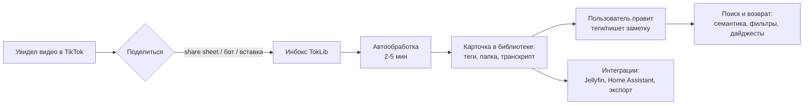
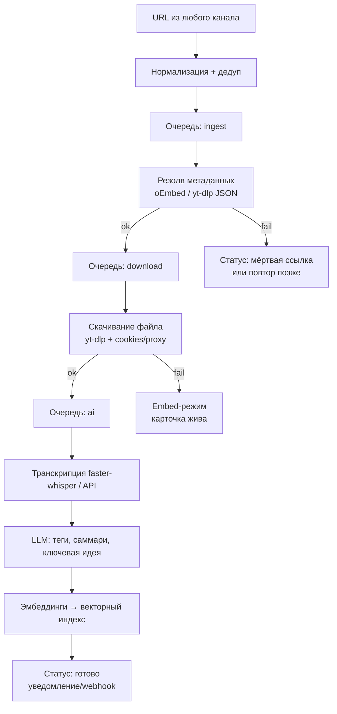

# 4. Пайплайны и дорожная карта

## 4.1. Пайплайн действий пользователя (жизненный цикл видео)

Развернуто по шагам:

1. **Приём (2 тапа).** Пользователь делится ссылкой из TikTok (share sheet / Telegram-бот / вставка в веб). Ничего настраивать в момент сохранения не нужно — это принципиальное отличие от нативных коллекций.
2. **Обработка (фон, минуты).** Система резолвит метаданные, скачивает файл (или переключается на embed), транскрибирует, ставит AI-теги. Пользователю остаётся только индикатор на карточке.
3. **Разбор (по желанию).** Периодический просмотр инбокса: подтвердить теги, перекинуть в папку, зафиксировать ключевую идею/заметку «зачем сохранил». Целевое время на видео — ≤ 10 секунд.
4. **Возврат (ценность).** Семантический поиск по памяти; лента-дайджест; «напомни непросмотренное»; просмотр на TV через Home Assistant/Jellyfin.
5. **Долгий архив.** Локальные копии переживают удаление видео с TikTok; полный экспорт данных в любой момент.

## 4.2. Пайплайн обработки данных (backend)

Требования к пайплайну: каждый этап — отдельный идемпотентный воркер с retry/backoff; сбой этапа не роняет очередь; приоритизация (свежие ссылки обрабатываются раньше бэклога из массового импорта). AI-стадии идут каскадом Tier-0 → Tier-1 с деградацией вместо блокировки; массовый импорт обрабатывается лениво (Tier-0 сразу, полный AI — по требованию и ночами) — docs/07.

## 4.3. Дорожная карта

Оценки для одного разработчика (fullstack) с AI-ассистированием; при 2–3 людях фазы сжимаются примерно вдвое.

### Фаза 0. Спайк и проверки осуществимости — 2 недели

- Спайк yt-dlp против TikTok: доля успешных скачиваний на 100 реальных ссылках (с cookies/прокси и без); частота поломок экстрактора; эталон embed-плеера.
- Спайк data export: парсинг реального JSON-архива избранного.
- Спайк STT: скорость/стоимость транскрипции 100 видео (faster-whisper локально vs API).
- Спайк AI-железа: замер faster-whisper (small/medium int8) и LLM 3–8B Q4 на профилях S/M/L (docs/08) — время конвейера на 100 видео; выбор моделей под язык пользователя по сету из 20 видео.
- Выбор названия, домен, репозиторий, CI.
- **Критерий go/no-go:** ≥ 80% ссылок резолвятся с метаданными; ≥ 60% скачиваются хотя бы одним способом. Если меньше — пересматривать стратегию (упор на embed+метаданные, без архива файлов).

### Фаза 1. MVP «Компаньон» — 6–8 недель

- Backend: API, БД (SQLite), инбокс, резолв метаданных, скачивание, статусы, очередь (минимальная).
- Каналы приёма: веб-вставка + Telegram-бот (нативное приложение — следующая фаза; бот доказывает habit loop дешевле).
- Web-панель: лента, папки, теги, плеер (локальный + embed), заметки, текстовый поиск, фильтры.
- Простые автотеги по подписи/хэштегам (без LLM — правило/словарь + опционально один вызов LLM).
- Docker compose; бэкап одной папкой.
- **Результат:** 20–50 пилотных пользователей из целевой аудитории. **Метрика:** ≥ 40% из них продолжают слать ссылки через 2 недели.

### Фаза 2. AI-слой «Второй мозг» — 6 недель

- Транскрипция с таймкодами; LLM-теги по содержимому; саммари; ключевая идея; гибридный семантический поиск — локальные модели по умолчанию, каскад и бюджеты по docs/07, провайдеры и пресеты — docs/08.
- Квоты/биллинг AI-операций; конфигурация моделей (облачные/локальные).
- Мобильное приложение (Flutter): share sheet как основной канал, оффлайн-просмотр.
- **Метрика:** ≥ 70% AI-тегов принимаются без правок; конверсия в платящий Pro ≥ 5% активных.

### Фаза 3. Self-hosted и интеграции — 6 недель

- Публичный Docker-образ one-command; WebDAV/SMB-хранилище; Jellyfin-экспорт (NFO+постеры).
- Home Assistant: кастомная интеграция HACS (сенсоры, сервисы, media_source).
- Массовый импорт из data export с прогрессом и приоритетами очереди.
- **Метрика:** ≥ 100 self-hosted установок; ≥ 30 активных интеграций HA.

### Фаза 4. Рост — постоянно

- Смарт-коллекции, дайджесты/напоминания, дедуп, «похожие», экспорт заметок в Obsidian/Notion.
- Браузерное расширение; мультиплатформа (Reels/Shorts) по данным спроса.
- Платный «архивный рывок» (разовая обработка стока).

## 4.4. Метрики успеха (продуктовые)

| Метрика | Цель на 6 мес |
|---|---|
| WAU пилотной когорты | ≥ 40% |
| Медиана библиотеки активного пользователя | ≥ 300 видео |
| Доля ссылок, проходящих пайплайн без ручного вмешательства | ≥ 90% |
| Конверсия free → Pro | ≥ 5% активных |
| Self-hosted установки | ≥ 100 |

## 4.5. Что делаем сразу (не откладываем)

- Изоляция download-провайдера за интерфейсом — с первого дня (главный технический риск).
- Docker-compose и переносимость данных — с первого коммита.
- Телеметри доли успешных скачиваний — чтобы видеть деградацию экстрактора раньше пользователей.
