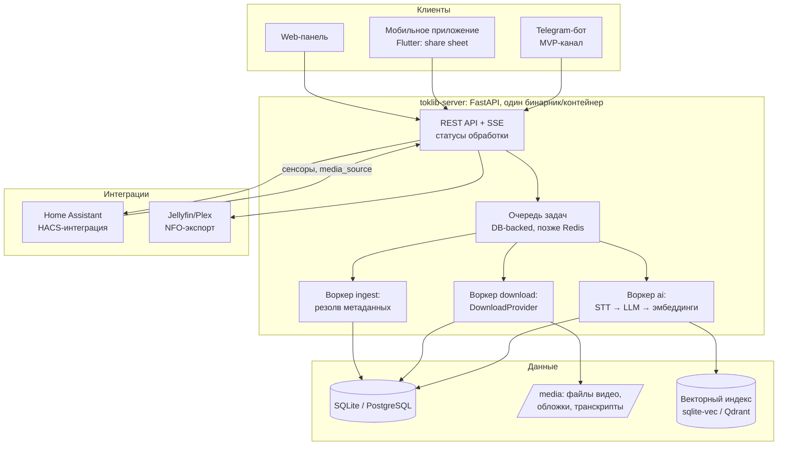

# 5. Архитектура

## 5.1. Принципы

1. **Embed-first, файл — максимум.** Карточка видео живёт и без скачанного файла; скачивание — улучшение, не условие работы.
2. **Скачивание за интерфейсом.** `DownloadProvider` — подключаемая стратегия (yt-dlp, альтернативы, «только embed»); поломки TikTok-экстрактора не трогают остальную систему.
3. **Local-first данные.** SQLite в one-binary режиме по умолчанию; все данные пользователя в одной папке; облако — опция, а не зависимость.
4. **AI локален по умолчанию.** Три интерфейса (`Transcriber` / `TextAnalyzer` / `Embedder`) за AI-маршрутизатором; облако — явный opt-in (docs/07–08, NFR-9).
5. **Очередь с первого дня** — обогащение всегда фоновое.
6. **Данные неизменяемы.** Канонический путь файла зависит только от `tiktok_id`; папки и экспортные деревья — представления, пересобираемые поверх (решение Р5, docs/06).

## 5.2. Компоненты



## 5.3. Стек

| Слой | Выбор | Почему |
|---|---|---|
| Backend | Python 3.12+, FastAPI, SQLAlchemy + Alembic | Нативная экосистема для yt-dlp/whisper; быстрая разработка |
| БД | SQLite (default) → PostgreSQL | Zero-config для self-hosted; лёгкий апгрейд |
| Очередь | DB-backed job table → Redis + ARQ | MVP без лишних сущностей; рост без переписывания |
| Скачивание | yt-dlp (nightly), cookies, прокси; провайдер изолирован | Лучшая поддержка TikTok при её хрупкости |
| STT | faster-whisper (default) / whisper.cpp (слабое железо) / STT API (opt-in) | Локальность по умолчанию; выбор — пресетами (docs/08) |
| LLM | Ollama (default) / llama.cpp / vLLM / любой OpenAI-совместимый API | Один интерфейс + маршрутизация с fallback (docs/08) |
| Эмбеддинги/поиск | sentence-transformers + sqlite-vec → Qdrant | Вектора прямо в SQLite на старте |
| Web | Next.js (React) | SSR-лента, PWA |
| Мобильное | Flutter | iOS+Android одной кодовой базой, share sheet |
| Telegram-бот | aiogram | Дешёвый MVP-канал приёма ссылок |
| Инфра | Docker, compose, GitHub Actions | Самохостинг и CI из коробки |

## 5.4. Модель данных (ядро)

```sql
video {
  id PK; tiktok_id UNIQUE; url; save_count INT DEFAULT 1;      -- дедуп: +1 при повторной ссылке (FR-1.4)
  author_username; author_display; author_avatar_url;
  caption; hashtags JSON; duration_sec; cover_url; published_at; saved_at;
  status       -- стадия конвейера: inbox|resolving|downloading|transcribing|analyzing|ready|error
  media_mode   -- что сохранено: none|embed|audio|file (не зависит от стадии, см. 5.9)
  health       -- живость ссылки на TikTok: unknown|alive|dead (FR-2.5)
  file_path NULL; file_size NULL; mime;
  viewed BOOL; favorite BOOL; last_error NULL
}

folder { id PK; name; parent_id FK→folder NULL; slug; icon }   -- вложенность ≤ 2
video_folder { video_id FK; folder_id FK }                     -- m2m; папки — только связи, не пути на диске

tag { id PK; name UNIQUE; kind }                                -- kind: ai|user|system
video_tag { video_id FK; tag_id FK; source }                    -- source: ai|user; UNIQUE(video,tag)

note { id PK; video_id FK; kind; text; timestamp_sec NULL;      -- kind: user|ai_summary|key_idea
       created_at; updated_at }

transcript { video_id FK; language; model; source;              -- source: ai|user_edit (FR-6.8)
             segments JSON }                                    -- [{start,end,text}]

analysis { id PK; video_id FK; model; prompt_version; input_hash;
           summary; key_idea; category; confidence; created_at } -- история прогонов; кэш по (model, prompt_version, input_hash)

embedding { entity_type; entity_id; model_id; dim;              -- векторы разных моделей не смешиваются
            content_hash; vector BLOB }                         -- смена модели → reindex (FR-6.9)

inbox_item { id PK; raw_text; url; source; status; error }      -- source: share|web|tg|import|ext|shortcut

job { id PK; type; payload JSON; status; priority; attempts; max_attempts;
      run_after; locked_by NULL; locked_at NULL;                -- lease: воркер берёт задачу в аренду
      last_error; idempotency_key UNIQUE }                      -- идемпотентность стадий (retry безопасен)
```

## 5.5. Ключевые API-эндпоинты

```
POST /api/inbox              — принять ссылку/текст (dedup → 200 существующее, 201 новое)
GET  /api/inbox?status=      — очередь с ошибками
GET  /api/videos             — лента: фильтры (folder,tag,author,status,viewed), поиск, пагинация
GET  /api/videos/{id}        — карточка: видео + теги + заметки + транскрипт + анализ
PATCH /api/videos/{id}       — viewed/favorite/status/папки
POST /api/videos/{id}/notes  — заметка (user), с timestamp_sec опционально
PATCH /api/videos/{id}/transcript — правка транскрипта пользователем (FR-6.8)
POST /api/videos/{id}/reanalyze — повторный AI-анализ, выбор модели (FR-6.9)
POST /api/folders | /api/tags — CRUD; POST /api/tags/merge
GET  /api/search?q=          — гибридный поиск (текст+вектор), операторы author:/tag:/folder:
POST /api/import/data-export — загрузка JSON-архива TikTok (Фаза 3)
POST /api/export             — полный экспорт библиотеки
GET  /api/media/{id}/file    — стриминг файла; /api/media/{id}/embed — редирект на TikTok-плеер
POST /api/system/retry/{id}  — перезапуск этапа пайплайна
GET  /api/system/ai        — модели, режимы, бюджеты, глубина очереди
POST /api/system/reindex   — переиндексация эмбеддингов (смена модели)
GET  /api/events (SSE)     — поток статусов обработки для UI (WS — если понадобится двусторонность)
```

Аутентификация: один токен (single-user) для MVP; сессии при мультиаккаунте (V1.1).

## 5.6. AI-слой (кратко)

Три интерфейса за AI-маршрутизатором: `Transcriber` (STT), `TextAnalyzer` (LLM), `Embedder` (вектора). Обработка каскадом: **Tier-0** (правила по подписи, без моделей) → **Tier-1** (локальные модели: faster-whisper, LLM 3–8B, sentence-transformers) → **Tier-2** (облако, opt-in). Один вызов LLM на видео с JSON-схемой; при сбоях — деградация, а не блокировка карточки; бюджеты и ленивая обработка бэклога.

Полная спецификация: `docs/07-ai-pipeline.md` (пайплайн и экономия), `docs/08-ai-providers.md` (провайдеры, конфигурация, пресеты железа).

## 5.7. Интеграции

### Home Assistant (Фаза 3, HACS custom component)

- **Сенсоры:** `sensor.toklib_new` (новые в инбоксе), `sensor.toklib_unwatched` (непросмотренные), `sensor.toklib_dead_links`.
- **Сервисы:** `toklib.add_url`, `toklib.search` → результат в уведомление/список.
- **MediaSource:** библиотека появляется в медиабраузере HA → просмотр на TV, кастинг на Chromecast.
- **Сценарии пользователей:** вечерний дайджест в Telegram/уведомления, автоматизация «в выходные показывать 5 непросмотренных рецептов».

### Jellyfin/Plex (Фаза 3)

- Экспортная структура: `/media/toklib/<Папка>/<tiktok-id>/video.mp4 + poster.jpg + movie.nfo` (NFO: заголовок = подпись, описание = саммари+ключевая идея, теги, автор как режиссёр).
- Jellyfin сканирует папку как библиотеку «Домашние видео» — никакого плагина не требуется.

### Телеметрия деградации

Фоновая задача раз в сутки: 10 случайных ссылок из очереди → замер доли успешных скачиваний; алерт при падении ниже порога (раннее обнаружение поломки экстрактора TikTok).

## 5.8. Развёртывание

**Self-hosted (минимум):** один контейнер `toklib` (API + воркеры + web-статика) + volume `/data` (SQLite, media, конфиг). `docker compose up` — всё.

**SaaS:** те же образы + PostgreSQL, Redis, Qdrant, S3-совместимое хранилище, reverse-proxy с TLS.

**Конфиг** (yaml): провайдер скачивания, AI-бэкенды и ключи, пути хранилища, квоты, Telegram-токен.

## 5.9. Статусная модель конвейера

`status` — только стадия конвейера; доступность носителя — `media_mode`; живость ссылки — `health` (см. 5.4). Разделение принципиально: карточка в embed-режиме может пройти весь AI (если аудио доступно), а карточка с файлом — застрять в `error`.

| Переход | Условие | При сбое |
|---|---|---|
| inbox → resolving | воркер взял задачу (lease) | lease истёк → задача возвращается в очередь, attempt+1 |
| resolving → downloading / embed | метаданные ok (oEmbed, fallback yt-dlp) | 404/приватное → `health=dead`, карточка завершается best-effort |
| downloading → transcribing | файл или audio-only сохранён | сеть → retry с backoff ×5 → embed-режим, AI отложен |
| transcribing → analyzing | транскрипт готов | сбой STT → analyzing всё равно (LLM по подписи, Tier-0) |
| analyzing → ready | JSON валиден или осознанная деградация Tier-0 | невалид ×2 → ready с флагом `partial_ai`, повтор ночью |

Ошибки делятся на **повторяемые** (сеть, таймаут: backoff 1/5/30 мин, ≤5 попыток) и **терминальные** (видео удалено/приватное). Исчерпавший попытки этап попадает в dead-letter (`status=error`, причина в `last_error`, кнопка повтора в UI → `POST /api/system/retry/{id}`). Сбой любого этапа не блокирует остальные (NFR-2).

## 5.10. Хранение и каталогизация

- Канонический путь неизменяем и не зависит от папок: `media/<id[0:2]>/<id[2:4]>/<tiktok_id>.mp4` (+ обложка рядом). Переименование папок не трогает файлы.
- `tmp/` — временные аудио для STT (16 кГц mono, ~0.2 МБ/мин), удаляются после транскрипции.
- Дерево для Jellyfin (FR-8.2) — генерируемое представление: `export/jellyfin/<Папка>/<tiktok-id>/{video.mp4 (hardlink), poster.jpg, movie.nfo}`; пересобирается при изменении метаданных. Hardlink требует одной ФС с `media/`, иначе symlink/копия.
- Audio-only режим (V1.1): сохраняется только звуковая дорожка — экономия диска в ~50–80× при сохранении STT/поиска; переключатель per-folder.
- Дисковый watermark: 90% — новые загрузки останавливаются (карточки в embed, AI через audio-only), 95% — предупреждение (FR-2.7).

## 5.11. Безопасность

- Аутентификация — статический токен (env) для всех клиентов и интеграций; мультиаккаунт — V1.1.
- Приём URL: allowlist хостов (`tiktok.com`, `*.tiktok.com`, короткие `vm.tiktok.com`/`vt.tiktok.com`) — отсекает SSRF и мусор; нормализация до канонического id до любого исходящего запроса.
- Раздача файлов — по id из БД (никаких пользовательских путей), стриминг с Range; в закрытом контуре — через reverse-proxy с проверкой токена.
- Секреты (ключи AI-провайдеров, токен Telegram) — только env, не в yaml и не в БД.
- Режим `local_only` — ни одного внешнего вызова AI-провайдеров; проверяется airgap-тестом в CI (NFR-9).

## 5.12. Эксплуатация

- **Бэкап:** online-бэкап SQLite (`.backup` API) + инкрементальный rsync/restic по `media/`; процедура восстановления документирована и проверяется скриптом (NFR-7).
- **Наблюдаемость:** глубина очереди и dead-letter, доля успешных скачиваний (телеметрия деградации, 5.7), времена стадий AI и доля валидного JSON; structured logs.
- **Диагностика:** `toklib doctor` — проверка провайдеров, железа, конфигурации; `toklib benchmark` — прогон конвейера на 10 случайных видео с временами по стадиям (docs/08.6).
- **Миграции:** Alembic при старте контейнера; смена модели эмбеддингов → `toklib reindex-embeddings`.
- **Compose-профили:** полный стек одним контейнером (default) или вынос AI-воркера/GPU отдельным сервисом (`base_url` на GPU-бокс, пресеты docs/08.6).
