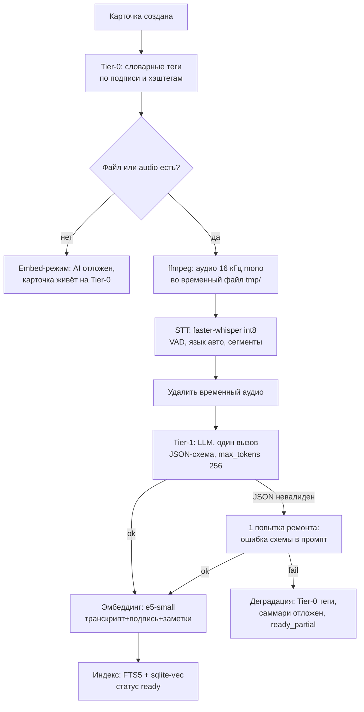

# 7. AI-пайплайн: максимальная экономия при работоспособном функционале

**Контекст:** проект self-hosted, поэтому «расходы» — это прежде всего время железа пользователя; API-деньги по умолчанию равны нулю. Документ определяет конвейер AI-обработки, реестр мер экономии токенов/времени, бюджеты и границы, за которыми экономить нельзя. Провайдеры и конфигурация — `docs/08-ai-providers.md`.

## 7.1. Принципы

1. **Ноль API-расходов по умолчанию.** STT, LLM-анализ и эмбеддинги — локальные модели на железе пользователя. Облако — явно включённый opt-in с ключами пользователя, а не скрытая зависимость.
2. **Каскад с деградацией, а не блокировкой.** У каждой стадии есть дешёвый fallback; сбой AI никогда не «вешает» карточку — минимум она получает Tier-0 теги по подписи.
3. **Compute тратим там, где пользователь видит ценность.** Открытая карточка и свежая ссылка — вперёд очереди; массовый бэклог из импорта — лениво и ночами с бюджетом.
4. **Один вызов LLM на видео.** Теги, саммари, ключевая идея, категория, язык — один структурированный JSON-ответ с жёстким лимитом выхода.
5. **Экономим токены, а не качество там, где оно чувствуется.** Не режем модель STT ниже минимума для языка пользователя, не выкидываем BM25 из поиска, даём пользователю править транскрипт и поднимать модель классом выше одним конфигом.

## 7.2. Три уровня обработки

| Уровень | Что входит | Стоимость | Когда выполняется |
|---|---|---|---|
| **Tier-0 — правила** | Нормализация подписи/хэштегов, словарные автотеги и категория по ключевым словам, детект языка по словарю | ~0 (миллисекунды CPU) | Всегда, сразу при приёме ссылки |
| **Tier-1 — локальные модели** | faster-whisper (STT) → LLM 3–8B Q4, один JSON-вызов → sentence-transformers (эмбеддинги) | $0 API, фоновое время CPU/GPU | По очереди с приоритетами и бюджетом |
| **Tier-2 — облако (opt-in)** | Дешёвый LLM API для бэклога или слабого железа; STT API для бёрста | центы–доллары на 1000 видео | Только по политике маршрутизации (08) |

Транскрипт короткого видео — сам по себе маленький вход: медиана TikTok ~45 с ≈ 100–150 слов ≈ 150–250 токенов. Дорогим массовым сценарий делает не один вызов, а количество вызовов и облако STT — поэтому экономия строится на каскаде, словарях и ленивой обработке.

## 7.3. Схема конвейера



Стадии и их параметры:

| Стадия | Вход → выход | Параметры экономии | Fallback |
|---|---|---|---|
| Извлечение аудио | файл → `tmp/*.opus` (16 кГц mono, ~0.2 МБ/мин) | временный файл, удаляется после STT | нет файла → STT отложен |
| STT | аудио → сегменты с таймкодами + язык | int8, VAD-фильтр (пропуск пауз), greedy `beam=1`, `condition_on_previous_text=False` | сбой → анализ по подписи (Tier-0) |
| LLM-анализ | транскрипт+подпись+словарь тегов → JSON | один вызов, `temperature 0.2`, `max_tokens 256`, JSON-схема, thinking-режим выключен | невалид ×2 → Tier-0 |
| Эмбеддинг | составной документ → вектор | e5-small (CPU, доли секунды), пересчёт по debounce | сбой → карточка без вектора, доиндексация ночным батчем |
| Индексация | FTS5 (BM25) + sqlite-vec, слияние RRF | оба индекса в той же SQLite | — |

## 7.4. Реестр мер экономии

| # | Мера | Эффект | Компромисс и его цена |
|---|---|---|---|
| 1 | Один вызов LLM на видео (всё в одном JSON) | в 3–4 раза меньше вызовов | нет |
| 2 | Закрытый словарь тегов: топ-40 из таксономии пользователя, ≤2 свободных новых | короче вывод, стабильные теги, нет зоопарка синонимов | пропуск новой темы — лечится свободными слотами |
| 3 | `max_tokens 256`, краткие поля (саммари ≤3 предложений, идея ≤140 симв.) | меньше генерации | саммари сжатые — это по ТЗ |
| 4 | Обрезка транскрипта до ~1500 токенов (начало+конец, «[…]» между) | покрывает ~99% TikTok | длинные видео теряют середину; полный анализ по запросу [V2] |
| 5 | few-shot 0–2 примера, включать только при замеренном приросте качества | −100–300 ток./вызов | чуть ниже точность на холодном старте |
| 6 | Кэш анализа по `(model, prompt_version, input_hash)` | retry и перезапуски не анализируют повторно | нет |
| 7 | Ленивый бэклог: импорту — Tier-0 сразу, полный AI по требованию и ночами | импорт 5000 видео не занимает железо на неделю | поиск по бэклогу сначала только по подписям — честно помечаем в UI |
| 8 | Приоритет очереди: открытая карточка → свежая ссылка → ночной бэклог | ценность там, где смотрят | нет |
| 9 | Бюджеты (видео/день, видео/ночь) | предсказуемая нагрузка | после исчерпания — деградация Tier-0, не затык |
| 10 | Дедуп на входе (`tiktok_id`, `save_count`) | ноль повторной обработки | нет |
| 11 | STT: int8 + VAD + greedy beam | в 2–5 раз быстрее | единичные ошибки распознавания — чинятся правкой транскрипта (FR-6.8) |
| 12 | Модель резидентна (`keep_alive`), конвейер последовательный (`concurrency=1` на CPU) | нет перезагрузок модели между карточками | пиковая нагрузка растянута во времени |
| 13 | Компактный системный промпт (~70 ток.), без истории диалога | меньше префикса | нет |
| 14 | Эмбеддинг заметок пересчитывается по debounce (закрытие карточки / ночной батч) | нет инференса на каждый ввод | вектор отстаёт от заметки на минуты — допустимо |

## 7.5. Скелет промпта

Системный (фиксированный, ~70 токенов):

```
Ты — каталогизатор персональной видеотеки. По транскрипту и подписи короткого
видео верни строго JSON по схеме. Без комментариев и markdown-обёрток.
Транскрипт содержит ошибки распознавания — не копируй их в теги и текст.
Саммари и ключевую идею пиши на языке транскрипта.
```

Пользовательский шаблон:

```
Подпись: {caption}
Хэштеги: {hashtags}
Теги библиотеки (предпочитай их): {tags_top40 | "нет"}
Категории: {categories_пользователя | рецепт|туториал|лайфхак|фитнес|другое}
Транскрипт: {transcript ≤1500 ток.}
```

Схема выхода:

```json
{
  "tags": ["1–3 слова", "3–7 шт., преимущественно из словаря"],
  "summary": "≤3 предложений, факты из транскрипта",
  "key_idea": "≤140 символов",
  "category": "из списка категорий",
  "content_language": "ISO-639-1"
}
```

Валидация pydantic-схемой; невалидный ответ → один повтор с текстом ошибки в промпте; второй провал → деградация на Tier-0 (теги по подписи, саммари отложен, флаг `partial_ai`). Структурные ограничения (JSON-schema / GBNF-грамматика) включаются там, где провайдер поддерживает (08.2) — это убирает большинство невалидных ответов ещё до повтора.

## 7.6. Бюджеты и конфигурация

```yaml
ai:
  mode: local_first              # local_only | local_first | cloud_only
  budgets:
    analysis_per_day: 0          # 0 = без лимита (self-hosted)
    nightly_backlog: 400         # видео/ночь на бэклог из импорта
    lazy_backlog: true           # импорт не гоняет полный AI сам
    stt_concurrency: 1           # CPU: последовательно; GPU: 2-4
```

Исчерпание дневного бюджета: новые видео получают Tier-0 сразу, полный AI — со следующего цикла; UI показывает честный статус («AI-очередь: бюджет исчерпан, обработка ночью»). Ночное окно (например 01:00–07:00) и лимит `nightly_backlog` защищают NAS от работы «днём под нагрузкой».

## 7.7. Оценка себестоимости (порядки величин)

На 1000 видео (медиана 45 с; ориентировочно — замерить в Фазе 0 на своём железе; облачные цены ноября 2026 проверить при внедрении):

| Компонент | Локально, CPU (профиль M) | Локально, GPU 8 ГБ (профиль L) | Облако |
|---|---|---|---|
| STT | $0, ~2–5 ч фоном | $0, ~10–30 мин (large-v3-turbo) | Whisper API ≈ $4.5; Groq turbo ≈ $0.5 |
| LLM-анализ | $0, ~4–8 ч (3–4B Q4, ~20–25 с/видео) | $0, ~30–60 мин (8B Q4) | ≈ $0.1–0.5 (flash/deepseek-класс: вход ~0.6M + выход ~0.15M ток.) |
| Эмбеддинги | $0, минуты | $0, минуты | ≈ $0.01 |
| **Итого** | **$0 API** | **$0 API** | **всё в облаке ≈ $5; гибрид (локальный STT + облачный LLM) < $1** |

Электричество — доли кВт·ч на 1000 видео, пренебрежимо. Вывод: при локальном STT даже облачный LLM стоит центы, потому что транскрипты короткие и вызов один; главная статья экономии — не гонять массово облако STT и не плодить лишних вызовов.

## 7.8. Границы экономии (что НЕ урезаем)

- **STT ниже small для русского контента — нет.** Ошибки распознавания тихо убивают поиск — самую ценную функцию; лучше медленнее, но читаемо. Компенсация ошибок — редактируемый транскрипт (FR-6.8), а не смирение.
- **Векторный поиск без BM25 — нет.** Короткие запросы, имена авторов, точные термы — территория полнотекстового индекса; гибрид обязателен.
- **Право поднять модель классом выше — да.** Один конфиг меняет 3B→8B→облако; пресеты в 08.
- **Метрики приёмки из ТЗ остаются.** ≥70% тегов без правок, top-10 поиск; если локальная модель их не даёт — меняем модель, а не метрику.
- **Честный статус в UI.** «Обработано частично (Tier-0)» — видимый статус, а не молчаливая деградация.

## 7.9. Критерии приёмки AI-слоя

- [ ] 100 видео: ≥95% валидного JSON с первой попытки (после включения схем/грамматик).
- [ ] Конвейер идемпотентен: повторный прогон не создаёт дублей анализа (кэш по `input_hash`).
- [ ] Метрики ТЗ: теги ≥70% приняты без правок; поиск «по смыслу» в top-10 на библиотеке от 500.
- [ ] Режим `local_only` не делает ни одного внешнего HTTP-вызова AI-провайдеров (airgap-тест в CI).
- [ ] Импорт 5000 ссылок: карточки с Tier-0 появляются в течение часа, железо не занято днём (ленивая обработка), ночной темп ≥ `nightly_backlog`.
- [ ] Смена модели эмбеддингов → `toklib reindex-embeddings` перестраивает индекс без потери данных.
